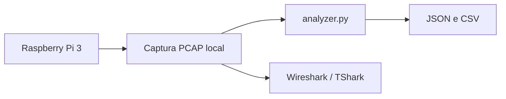

# Raspberry CyberLab

**CyberLab Forensic Analyzer 0.1.0** — análise de tráfego TCP em Python. Entrega acadêmica prevista: **24/11/2026**.

Este README é o roteiro da apresentação: explicar o objetivo, mostrar a arquitetura, executar o analisador e conferir os resultados. Os nomes dos integrantes serão preenchidos pela equipe.

## 1. Objetivo do projeto

O Raspberry CyberLab estuda como os pacotes TCP permitem distinguir uma conexão estabelecida de uma tentativa recusada. Para isso, usamos uma captura local do laboratório e desenvolvemos um analisador em Python.

O programa lê um arquivo PCAP, resume o tráfego por IP e porta, calcula SHA-256 e gera relatórios em JSON e CSV. Cada classificação aponta os pacotes que a sustentam.

## 2. Arquitetura do laboratório



O PCAP documentado contém tráfego de loopback: origem e destino são `127.0.0.1`. A análise foi executada no Windows e no Raspberry, e os relatórios foram comparados.

A imagem da arquitetura poderá ser adicionada aqui depois, como `docs/arquitetura.png`, substituindo o diagrama acima.

## 3. Ferramentas utilizadas

| Recurso | Função |
| --- | --- |
| Raspberry Pi 3 Model B Rev 1.2 | Equipamento informado para o laboratório |
| Debian GNU/Linux 13 e Python 3.13.5 | Ambiente consultado no Raspberry |
| Python 3.10 ou superior | Executar o analisador com a biblioteca padrão, sem instalar pacotes |
| Nmap e tcpdump | Ferramentas associadas ao experimento de reconhecimento e captura |
| Wireshark / TShark | Inspecionar os pacotes e comparar os resultados |
| Windows com Python 3.12.3 | Ambiente usado no desenvolvimento e na validação direta |

Os comandos originais do Nmap e do tcpdump que produziram o PCAP principal não foram recuperados. O modelo e as versões do Raspberry foram fornecidos por transcrições de terminal na coleta complementar.

## 4. Como o programa funciona

Toda a aplicação está em **[analyzer.py](analyzer.py)**.

1. Abre o PCAP em modo de leitura e verifica seu formato.
2. Calcula SHA-256 sobre os mesmos bytes usados na análise.
3. Interpreta os cabeçalhos TCP/IPv4 e resume os fluxos por IP e porta.
4. Correlaciona as tentativas pela direção, pelos números de sequência e pelos ACKs.
5. Classifica os padrões observados e guarda os números dos pacotes de evidência.
6. Gera um JSON e três CSVs.

| Padrão observado | Interpretação no analisador |
| --- | --- |
| SYN → SYN/ACK → ACK, com SEQ/ACK compatíveis | Tentativa aberta, com handshake completo |
| SYN → RST/ACK do destino, reconhecendo o SYN | Tentativa fechada |
| SYN sem resposta correlacionável ou SYN/ACK sem ACK final | Evidência incompleta; resumo de porta inconclusivo quando não há outra tentativa confirmada |

Um reset enviado depois do handshake não desfaz a evidência de abertura. A janela padrão de correlação é de 60 segundos desde o SYN.

## 5. Demonstração prática

Abra o terminal na pasta do repositório. O PCAP deve estar disponível localmente; ele não é distribuído neste repositório.

**No Windows, usando PowerShell:**

```powershell
python analyzer.py "$HOME\Downloads\experimento-nmap.pcap" --output-dir relatorios-demonstracao --expect-sha256 ddd44c144ea60620c3fcf4a1e2ef9c7e53ed643b291642f11c896322f6c59a8e
```

Se `python` não estiver disponível, use `py -3` no lugar dele.

**No Raspberry/Linux, usando o nome confirmado no equipamento:**

```bash
python3 analyzer.py "$HOME/Cyberlab/capturas/expermiremnto-nmap.pcap" --output-dir relatorios-demonstracao --expect-sha256 ddd44c144ea60620c3fcf4a1e2ef9c7e53ed643b291642f11c896322f6c59a8e
```

O hash acima é específico do experimento 01. Para outra captura, use o caminho e o hash correspondentes ou omita `--expect-sha256`. Em uma nova execução, escolha outra pasta de saída se ela já contiver relatórios.

### Saída do experimento validado

```text
CyberLab 0.1.0 | 2002 pacotes | 2002 TCP
SHA-256: ddd44c144ea60620c3fcf4a1e2ef9c7e53ed643b291642f11c896322f6c59a8e
Tentativas: {"aberta": 1, "fechada": 999}
Pacotes ignorados: 0
```

### Arquivos gerados

| Arquivo | O que mostrar na apresentação |
| --- | --- |
| `relatorio.json` | SHA-256, metadados e evidências numeradas |
| `portas.csv` | IP/porta de destino e classificação |
| `tentativas.csv` | Os pacotes SYN, SYN/ACK, ACK e RST de cada tentativa |
| `fluxos-tcp.csv` | Contagem de pacotes, bytes e flags por direção |

Os CSVs usam vírgula e UTF-8 com BOM. No Excel, use **Dados → De Texto/CSV** se precisar ajustar o delimitador.

## 6. Resultados e conferência no Wireshark

| Porta | Pacotes de evidência | Sequência observada | Resultado |
| --- | --- | --- | --- |
| 22/TCP | 19 → 20 → 21 | SYN → SYN/ACK → ACK | Aberta |
| 23/TCP | 31 → 32 | SYN → RST/ACK | Fechada |

A captura contém **2.002 pacotes TCP**, **2.000 fluxos direcionais** e **1.000 tentativas**: **1 aberta e 999 fechadas**.

No Wireshark, abra o PCAP local e aplique `tcp.port == 22`. Mostre os pacotes 19, 20 e 21. Depois aplique `tcp.port == 23` e compare os pacotes 31 e 32.

Para conferir o resumo no PowerShell após executar o exemplo:

```powershell
Import-Csv .\relatorios-demonstracao\portas.csv | Where-Object { $_.server_port -in '22','23' } | Format-Table server_ip,server_port,classification,attempts
```

## 7. Testes e validação

Os testes estão separados da aplicação em **[tests/test_analyzer.py](tests/test_analyzer.py)**. Eles verificam sequências TCP, respostas incorretas, retransmissões, arquivos inválidos, integridade e exportação, além do PCAP real quando disponível.

**Windows:**

```powershell
python -m unittest discover -v
```

**Raspberry/Linux, indicando a captura do experimento:**

```bash
CYBERLAB_TEST_PCAP="$HOME/Cyberlab/capturas/expermiremnto-nmap.pcap" python3 -m unittest discover -v
```

| Validação registrada | Aprovados | Ignorados |
| --- | ---: | ---: |
| Windows, com PCAP real e TShark | 21 | 0 |
| Raspberry, conforme saídas fornecidas pelo usuário | 20 | 1, por ausência do TShark |

Na comparação direta dos relatórios recebidos do Raspberry, os três CSVs eram **idênticos byte por byte** aos do Windows. No JSON, somente o horário da análise e o nome do arquivo de entrada diferiam.

Sem o PCAP, os testes reais são ignorados. Sem TShark, a comparação independente é ignorada. Confira a linha final dos testes para distinguir verificações aprovadas de verificações não executadas.

## 8. Limitações e conclusão

A primeira versão lê **PCAP clássico e TCP/IPv4**. Ela não lê PCAPNG/IPv6, não remonta fragmentos e não valida checksums ou autenticações de aplicação.

As classificações descrevem o padrão registrado na captura. Elas não garantem o estado atual de uma porta nem identificam, sozinhas, o serviço executado. O handshake da porta 22 não comprova login SSH ou invasão. SHA-256 identifica o conteúdo, mas não prova sozinho sua origem.

O analisador reproduziu os resultados do experimento nos ambientes documentados e permitiu relacionar cada classificação aos pacotes correspondentes. A técnica exata da varredura e a interface original permanecem não confirmadas.

## 9. Organização do repositório

```text
raspberry-cyberlab/
├── README.md                 # Explicação e roteiro da demonstração
├── analyzer.py               # Aplicação completa em um único arquivo
├── tests/
│   ├── __init__.py
│   └── test_analyzer.py       # Testes automatizados
├── docs/
│   └── relatorio.md          # Relatório acadêmico e registros essenciais
├── .gitignore                # Mantém capturas, relatórios e backups fora do Git
└── .gitattributes            # Padroniza os arquivos de texto
```

O material escrito está no **[relatório acadêmico](docs/relatorio.md)**. A apresentação será conduzida por este README e pela demonstração do programa.

**Repositório:** [Edudsprado/raspberry-cyberlab](https://github.com/Edudsprado/raspberry-cyberlab).
