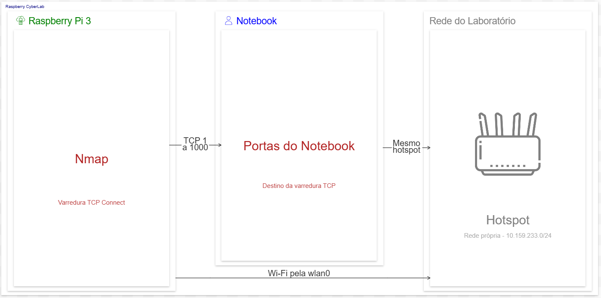
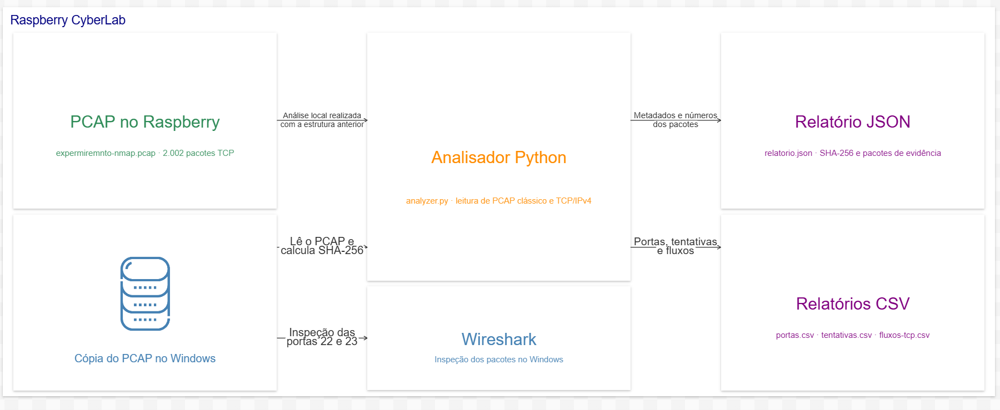
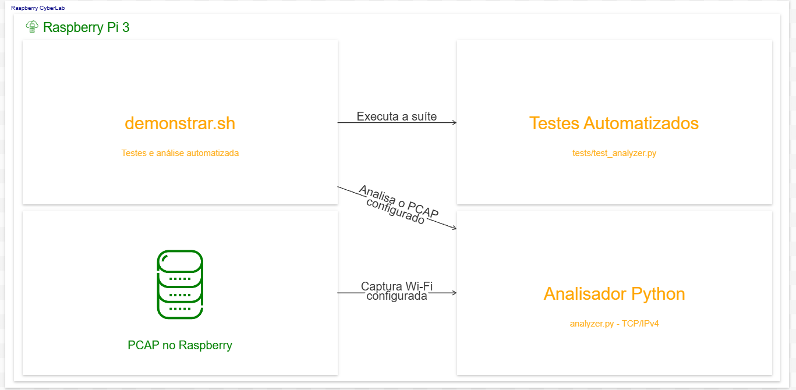

# Raspberry CyberLab

**CyberLab Forensic Analyzer 0.1.0** — análise de tráfego TCP em Python.


## 1. Objetivo do projeto

O Raspberry CyberLab estuda como os pacotes TCP permitem distinguir uma conexão estabelecida de uma tentativa recusada. Para isso, usamos uma captura local do laboratório e desenvolvemos um analisador em Python.

O programa lê um arquivo PCAP, resume o tráfego por IP e porta, calcula SHA-256 e gera relatórios em JSON e CSV. Cada classificação aponta os pacotes que a sustentam.

O analisador desenvolvido em Python:

- Lê arquivos PCAP locais.
- Resume o tráfego TCP por IP e porta.
- Identifica padrões de abertura e recusa de conexão.
- Registra os números dos pacotes que sustentam cada classificação.
- Calcula SHA-256 e gera relatórios em JSON e CSV.

A demonstração utiliza uma captura já coletada no laboratório. Sua execução analisa esse arquivo, sem iniciar uma nova varredura.

## 2. Arquitetura do laboratório

### Experimento local



O PCAP contém 2.002 pacotes TCP em loopback (`127.0.0.1`). O arquivo foi copiado para o Windows via SCP, e o SHA-256 da cópia coincidiu com o do original.

### Investigação forense



O `analyzer.py` lê o PCAP e gera relatórios em JSON e CSV. No Wireshark, a conferência visual usa os pacotes das portas 22 e 23.

### Testes e validação



A suíte usa capturas sintéticas e o PCAP real. O TShark serviu de referência independente no Windows, e os três CSVs gerados nas execuções comparadas foram idênticos nos dois sistemas.

## 3. Ferramentas utilizadas

| Recurso | Função |
| --- | --- |
| Raspberry Pi 3 Model B Rev 1.2 | Equipamento informado para o laboratório |
| Debian GNU/Linux 13 e Python 3.13.5 | Ambiente consultado no Raspberry |
| Python 3.10 ou superior | Executar o analisador com a biblioteca padrão, sem instalar pacotes |
| Nmap e tcpdump | Ferramentas associadas ao experimento de reconhecimento e captura |
| Wireshark / TShark | Inspecionar os pacotes e comparar os resultados |
| Windows com Python 3.12.3 | Ambiente usado no desenvolvimento e na validação direta |

Os comandos originais do Nmap e do tcpdump que produziram o PCAP principal não foram recuperados. O modelo e as versões do Raspberry foram fornecidos por transcrições de terminal na coleta complementar.

## 4. Como o programa funciona

Toda a aplicação está em **[analyzer.py](analyzer.py)**.

1. Abre o PCAP em modo de leitura e verifica seu formato.
2. Calcula SHA-256 sobre os mesmos bytes usados na análise.
3. Interpreta os cabeçalhos TCP/IPv4 e resume os fluxos por IP e porta.
4. Correlaciona as tentativas pela direção, pelos números de sequência e pelos ACKs.
5. Classifica os padrões observados e guarda os números dos pacotes de evidência.
6. Gera um JSON e três CSVs.

| Padrão observado | Interpretação no analisador |
| --- | --- |
| SYN → SYN/ACK → ACK, com SEQ/ACK compatíveis | Tentativa aberta, com handshake completo |
| SYN → RST/ACK do destino, reconhecendo o SYN | Tentativa fechada |
| SYN sem resposta correlacionável ou SYN/ACK sem ACK final | Evidência incompleta; resumo de porta inconclusivo quando não há outra tentativa confirmada |

Um reset enviado depois do handshake não desfaz a evidência de abertura. A janela padrão de correlação é de 60 segundos desde o SYN.

## 5. Demonstração prática

Nesta demonstração, o Raspberry executa uma varredura autorizada do notebook conectado ao mesmo hotspot. O tráfego é capturado e depois examinado pelo **CyberLab Forensic Analyzer**.

| Ferramenta | Função |
| --- | --- |
| Nmap | Executar a varredura de portas |
| tcpdump | Registrar os pacotes em um arquivo PCAP |
| `analyzer.py` | Analisar o PCAP, calcular SHA-256 e gerar relatórios |

### 5.1. Conferir a rede

No Raspberry, execute:

```bash
ip -br addr
ip route
```

No experimento realizado, os endereços eram:

| Recurso | Endereço |
| --- | --- |
| Interface do Raspberry | `wlan0` |
| Raspberry | `10.159.233.58` |
| Notebook autorizado | `10.159.233.136` |
| Rede do hotspot | `10.159.233.0/24` |

Os endereços podem mudar após uma reconexão. Antes de repetir o experimento, confirme o IP do notebook e substitua-o nos comandos de captura e varredura.

### 5.2. Iniciar a captura

No primeiro terminal do Raspberry, crie uma pasta exclusiva para a execução:

```bash
execucao=$(mktemp -d "$HOME/Cyberlab/capturas/wlan.XXXXXX")
```

Inicie a captura do tráfego TCP envolvendo o notebook:

```bash
sudo tcpdump -i wlan0 -nn -s 0 -U -w "$execucao/captura.pcap" 'tcp and host 10.159.233.136'
```

Mantenha esse terminal aberto e capturando.

### 5.3. Executar a varredura

Em um **segundo terminal conectado ao Raspberry**, execute:

```bash
nmap -sT -Pn -p 1-1000 --reason 10.159.233.136
```

O comando realiza uma varredura TCP Connect das portas 1 a 1000 do notebook e apresenta o motivo de cada classificação.

Quando o Nmap terminar, volte ao primeiro terminal e pressione **Ctrl+C** para encerrar a captura.

### 5.4. Executar o analisador forense

No **primeiro terminal**, onde a variável `execucao` foi criada, execute:

```bash
python3 "$HOME/Cyberlab/raspberry-cyberlab/analyzer.py" "$execucao/captura.pcap" --output-dir "$execucao/relatorios"
```

É nesta etapa que atua a ferramenta desenvolvida no projeto. Ela:

1. Lê os pacotes do PCAP.
2. Calcula o SHA-256 da captura.
3. Correlaciona as tentativas TCP.
4. Identifica padrões de conexão estabelecida, recusa e ausência de resposta correlacionada.
5. Gera relatórios com referências aos pacotes de evidência.

O analisador examina os IPs e portas presentes na captura. Não é necessário editar seu código para cada alvo.

### 5.5. Mostrar as portas abertas

Ainda no primeiro terminal, execute:

```bash
python3 -c 'import csv,sys; f=open(sys.argv[1], encoding="utf-8-sig", newline=""); print("IP | PORTA | CLASSIFICAÇÃO"); [print(r["server_ip"], r["server_port"], r["classification"], sep=" | ") for r in csv.DictReader(f) if r["classification"] == "aberta"]' "$execucao/relatorios/portas.csv"
```

Compare essa saída com as portas abertas informadas pelo Nmap.

Os resultados de uma nova execução dependem dos serviços ativos, das regras de firewall e das condições da rede naquele momento.

### 5.6. Resultados do experimento realizado

O Nmap apresentou:

```text
Not shown: 997 closed tcp ports (conn-refused)

PORT    STATE SERVICE      REASON
135/tcp open  msrpc        syn-ack
139/tcp open  netbios-ssn  syn-ack
445/tcp open  microsoft-ds syn-ack
```

O CyberLab apresentou:

```text
CyberLab 0.1.0 | 2361 pacotes | 2361 TCP
SHA-256: 2753499a843d338d8932897adf4fc02c9d3b88a67242ce28ba3178a42f2afea8
Tentativas: {"aberta": 3, "fechada": 997, "sem_resposta": 1}
Pacotes ignorados: 0
```

A comparação das portas abertas foi:

| Porta | Nmap | CyberLab |
| --- | --- | --- |
| 135/TCP | Aberta | Aberta |
| 139/TCP | Aberta | Aberta |
| 445/TCP | Aberta | Aberta |

As três portas abertas coincidiram. O Nmap informou 997 portas fechadas, enquanto o analisador registrou 997 tentativas fechadas.

O analisador também registrou uma tentativa sem resposta correlacionada para a porta 543. Por isso, o total de tentativas não deve ser tratado como uma contagem de portas distintas. Essa ocorrência não foi investigada em profundidade.

Os nomes de serviços exibidos pelo Nmap são associações às portas; a execução não confirmou versões nem demonstrou vulnerabilidades.

### 5.7. Consultar os arquivos gerados

Para mostrar o caminho da execução:

```bash
printf '%s\n' "$execucao"
```

Cada execução produz:

```text
wlan.XXXXXX/
├── captura.pcap
└── relatorios/
    ├── relatorio.json
    ├── portas.csv
    ├── tentativas.csv
    └── fluxos-tcp.csv
```

| Arquivo | Conteúdo |
| --- | --- |
| `captura.pcap` | Pacotes registrados durante o experimento |
| `relatorio.json` | Hash, metadados, classificações e referências de evidência |
| `portas.csv` | Resumo por IP e porta |
| `tentativas.csv` | Tentativas e pacotes associados |
| `fluxos-tcp.csv` | Contagens de pacotes, bytes e flags por direção |

No experimento documentado, os arquivos foram salvos em:

```text
/home/cyber/Cyberlab/capturas/wlan.1nBw2Q/
```

Uma nova captura terá seu próprio conteúdo, SHA-256 e resultados.

### 5.8. Demonstração automatizada do experimento original

O repositório também possui um script para repetir a validação da captura original de loopback:

```bash
cd "$HOME/Cyberlab/raspberry-cyberlab"
sh demonstrar.sh
```

Esse script executa os testes, confere o hash esperado, analisa o PCAP original e mostra as portas 22 e 23. Os relatórios e o log são salvos em uma pasta `relatorios-demonstracao.XXXXXX`.

**O `demonstrar.sh` atual não realiza uma nova varredura nem captura tráfego pela Wi-Fi.** Seu PCAP, hash esperado e filtro de exibição são específicos do experimento original. A demonstração com o notebook utiliza as etapas de coleta e análise descritas acima.

## 6. Resultados e conferência no Wireshark

| Porta | Pacotes de evidência | Sequência observada | Resultado |
| --- | --- | --- | --- |
| 22/TCP | 19 → 20 → 21 | SYN → SYN/ACK → ACK | Aberta |
| 23/TCP | 31 → 32 | SYN → RST/ACK | Fechada |

A captura contém **2.002 pacotes TCP**, **2.000 fluxos direcionais** e **1.000 tentativas**: **1 aberta e 999 fechadas**.

No Wireshark, abra o PCAP local e aplique `tcp.port == 22`. Mostre os pacotes 19, 20 e 21. Depois aplique `tcp.port == 23` e compare os pacotes 31 e 32.

Para conferir o resumo no PowerShell após executar o exemplo:

```powershell
Import-Csv .\relatorios-demonstracao\portas.csv | Where-Object { $_.server_port -in '22','23' } | Format-Table server_ip,server_port,classification,attempts
```

## 7. Testes e validação

A validação reúne os testes automatizados do programa e a comparação dos resultados obtidos nos experimentos.

### Testes automatizados

Os testes estão em **[tests/test_analyzer.py](tests/test_analyzer.py)** e verificam:

- Handshakes completos e recusas de conexão.
- Respostas incompatíveis, retransmissões e sequências incompletas.
- Arquivos inválidos ou truncados.
- Cálculo de SHA-256 e geração dos relatórios.
- Resultados esperados da captura original.
- Comparação independente com TShark, quando disponível.

Execute os comandos na pasta do repositório.

**Windows / PowerShell:**

```powershell
$env:CYBERLAB_TEST_PCAP = "$HOME\Downloads\experimento-nmap.pcap"
python -m unittest discover -v
```

**Raspberry / Linux:**

```bash
CYBERLAB_TEST_PCAP="$HOME/Cyberlab/capturas/expermiremnto-nmap.pcap" python3 -m unittest discover -v
```

Os testes reais foram preparados para a **captura original do experimento 01**. Não se deve substituir esse arquivo por uma nova captura e esperar as mesmas contagens.

| Validação registrada | Aprovados | Ignorados |
| --- | ---: | ---: |
| Windows, com PCAP original e TShark | 21 | 0 |
| Raspberry, com PCAP original e sem TShark | 20 | 1 |

Na comparação anterior dos relatórios do Windows e do Raspberry, os três CSVs foram **idênticos byte por byte**. No JSON, diferiram apenas o horário da análise e o nome do arquivo de entrada.

Sem a captura disponível, os testes reais são ignorados. Sem TShark, a comparação independente é ignorada. Um teste ignorado não conta como aprovado.

### Validação do experimento pela Wi-Fi

Um segundo experimento utilizou o Raspberry para realizar uma varredura autorizada do notebook conectado ao mesmo hotspot.

O tráfego foi capturado pela interface `wlan0` e analisado com `analyzer.py`.

| Resultado | Nmap | CyberLab |
| --- | --- | --- |
| Portas abertas | 135, 139 e 445 | 135, 139 e 445 |
| Fechadas | 997 portas | 997 tentativas |

A captura continha **2.361 pacotes TCP**, sem pacotes ignorados pelo analisador.

O CyberLab também identificou uma tentativa sem resposta correlacionada para a porta 543. Essa ocorrência não foi investigada em profundidade. Portanto, a comparação confirma a concordância das portas abertas, sem estabelecer equivalência completa entre todas as tentativas e as classificações do Nmap.

Essa análise foi executada diretamente com `analyzer.py`. O `demonstrar.sh` permanece destinado à validação da captura original.

## 8. Limitações e conclusão

A versão 0.1.0 oferece suporte a **PCAP clássico e TCP/IPv4**. Ela não lê PCAPNG ou IPv6, não remonta fragmentos e não valida checksums ou autenticações de aplicação.

As classificações descrevem os padrões registrados na captura:

- Um handshake completo evidencia uma conexão estabelecida.
- Um RST/ACK compatível em resposta ao SYN evidencia uma tentativa recusada.
- A ausência de resposta correlacionada não comprova, isoladamente, bloqueio por firewall.

Os resultados não garantem o estado atual das portas nem identificam, sozinhos, os serviços executados. Uma conexão na porta 22 não comprova login SSH. Os nomes de serviços apresentados pelo Nmap na varredura realizada são associações às portas, sem confirmação de versões.

O SHA-256 permite comparar o conteúdo dos arquivos e detectar alterações, mas não comprova sozinho sua origem.

O projeto foi aplicado em dois cenários:

| Experimento | Escopo |
| --- | --- |
| Captura original | Tráfego local em `127.0.0.1`, validado no Windows e no Raspberry |
| Captura pela Wi-Fi | Varredura TCP Connect do notebook pelo hotspot, com captura na `wlan0` |

Foi recuperado um registro de execução do Nmap relacionado ao experimento local, mas sua correspondência exata com a captura original não foi comprovada. O comando de captura original também permanece não confirmado. No experimento pela Wi-Fi, os comandos e a interface utilizados foram registrados durante a execução.

A contribuição acadêmica consiste em implementar a correlação dos pacotes TCP, apresentar evidências para as classificações e comparar os resultados com ferramentas existentes.

## 9. Organização do repositório

### Arquivos disponíveis no GitHub

```text
raspberry-cyberlab/
├── README.md                 # Explicação e roteiro da demonstração
├── analyzer.py               # Analisador completo
├── demonstrar.sh             # Demonstração automatizada do experimento original
├── tests/
│   ├── __init__.py
│   └── test_analyzer.py       # Testes automatizados
├── docs/
│   ├── relatorio.md          # Relatório acadêmico
│   ├── arquitetura.png
│   ├── investigacao-forense.png
│   └── testes-e-validacao.png
├── .gitignore                # Exclui capturas, resultados e caches do Git
└── .gitattributes            # Padroniza as terminações de linha
```

### Dados locais no Raspberry

As capturas e os resultados ficam separados do código distribuído no GitHub.

```text
/home/cyber/Cyberlab/
├── capturas/
│   ├── expermiremnto-nmap.pcap
│   ├── teste-inicial.pcap
│   └── wlan.1nBw2Q/
│       ├── captura.pcap
│       └── relatorios/
│           ├── relatorio.json
│           ├── portas.csv
│           ├── tentativas.csv
│           └── fluxos-tcp.csv
├── evidencias/
│   └── SHA256SUMS.txt
├── relatorios/
│   ├── ambiento01.txt
│   └── nmap-local.txt
└── raspberry-cyberlab/
    ├── analyzer.py
    ├── demonstrar.sh
    ├── tests/
    ├── docs/
    └── relatorios-demonstracao.XXXXXX/
```

A pasta `relatorios` também pode reunir os quatro relatórios da primeira validação, após a transferência da antiga pasta `relatorios-raspberry-01`.

Cada nova coleta cria uma pasta própria em `capturas`. Cada execução do `demonstrar.sh` cria uma pasta de resultados dentro do repositório local. Os nomes com sufixo variável distinguem as execuções e preservam os arquivos anteriores.

O `SHA256SUMS.txt` existente registra os arquivos do experimento original; a nova captura possui seu hash registrado no respectivo `relatorio.json`.

As capturas, os relatórios gerados e os logs locais não são baixados pelo `git clone`.

## 10. Autor do repositório

<table>
  <tr>
    <td align="center">
      <a href="https://github.com/edudsprado" title="Perfil Eduardo">
        <br>
        <sub>
          <b>Eduardo Prado</b>
        </sub>
      </a>
    </td>
  </tr>
</table>
