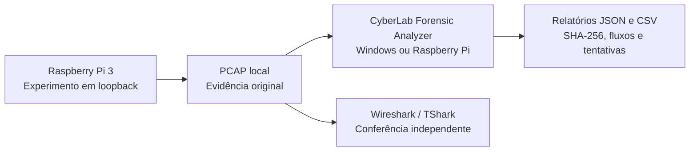

# Raspberry CyberLab

**CyberLab Forensic Analyzer 0.1.0** · Projeto acadêmico de redes e segurança · Entrega prevista em **24/11/2026**.

[Começar pelo guia rápido](docs/inicio-rapido.md) · [Ver o experimento](docs/analise-forense.md) · [Conferir os testes](docs/testes-automatizados.md)

## Visão geral

O Raspberry CyberLab reúne uma captura feita em laboratório e um analisador Python que lê arquivos PCAP locais. O objetivo é mostrar, pelos pacotes observados, a diferença entre uma conexão TCP estabelecida e uma tentativa que recebeu um reset.

O analisador resume os fluxos por IP e porta, conta as combinações de flags TCP, calcula o SHA-256 do arquivo e exporta relatórios em JSON e CSV. Cada classificação aponta para os números dos pacotes que a sustentam.

## Arquitetura do laboratório



| Etapa | Papel no projeto |
| --- | --- |
| Experimento no Raspberry | O tráfego observado na captura usa `127.0.0.1` nos dois sentidos |
| Análise em Python | Lê TCP/IPv4 no PCAP, correlaciona SYN, SYN/ACK, ACK e RST/ACK e grava os relatórios |
| Conferência independente | O Wireshark permite inspecionar os pacotes e o TShark compara campos e contagens automaticamente |
| Validação entre plataformas | Windows e Raspberry analisaram cópias com o mesmo SHA-256 e produziram resultados equivalentes |

O diagrama representa o fluxo da evidência. O registro do experimento descreve o que se sabe sobre os comandos e a interface originais. [Ver o registro](docs/registro-experimento-01.md)

## Tecnologias e ambientes

| Recurso | Uso |
| --- | --- |
| Raspberry Pi 3 Model B Rev 1.2 | Equipamento informado para o laboratório e para a execução no Debian 13 com Python 3.13.5 |
| Python 3.10 ou superior | Leitura, análise e exportação com a biblioteca padrão. Python 3.12.3 usado na validação no Windows |
| Nmap e tcpdump | Ferramentas associadas à varredura e à coleta do experimento original |
| Wireshark e TShark | Inspeção manual e comparação automatizada. O TShark é opcional para executar os testes |
| PowerShell e shell POSIX | Atalhos de teste no Windows e no Raspberry/Linux |

## Estrutura do repositório

| Caminho | Conteúdo |
| --- | --- |
| [`cyberlab/`](cyberlab/) | Leitor PCAP, correlacionador TCP e interface de linha de comando |
| [`tests/`](tests/) | Testes com capturas sintéticas e verificações do PCAP real quando disponível |
| [`testar.cmd`](testar.cmd) e [`testar.sh`](testar.sh) | Atalhos para executar a suíte de testes |
| [`scripts/run_tests.py`](scripts/run_tests.py) | Executor compartilhado que salva o log e o resumo em JSON |
| [`docs/`](docs/) | Guias, metodologia, validação e materiais da apresentação |

## Como executar

**1. Abra o terminal na pasta do projeto.** Use Python 3.10 ou superior. O analisador funciona com a biblioteca padrão e pode ser executado com sua conta normal.

**2. Informe a captura local.** Para o experimento documentado, o valor abaixo verifica o SHA-256 conhecido antes de gerar os relatórios.

No PowerShell do Windows:

```powershell
python -m cyberlab "$HOME\Downloads\experimento-nmap.pcap" --output-dir relatorios-experimento-01 --expect-sha256 ddd44c144ea60620c3fcf4a1e2ef9c7e53ed643b291642f11c896322f6c59a8e
```

No Raspberry, com a grafia usada no arquivo original:

```sh
python3 -m cyberlab "$HOME/Cyberlab/capturas/expermiremnto-nmap.pcap" --output-dir relatorios-experimento-01 --expect-sha256 ddd44c144ea60620c3fcf4a1e2ef9c7e53ed643b291642f11c896322f6c59a8e
```

Para analisar outra captura em PCAP clássico, informe o caminho correspondente e use seu próprio SHA-256 ou omita `--expect-sha256`. Se a pasta de saída já contiver relatórios, escolha outro nome. Para o passo a passo e alternativas no Windows, consulte o [guia rápido](docs/inicio-rapido.md).

**3. Abra os relatórios gerados.**

| Arquivo | O que conferir |
| --- | --- |
| `relatorio.json` | SHA-256, contagem de pacotes, tentativas e evidências numeradas |
| `portas.csv` | Classificação por IP e porta de destino |
| `tentativas.csv` | Números dos pacotes associados a cada tentativa |
| `fluxos-tcp.csv` | Tráfego por direção, volumes e combinações de flags |

Os CSVs usam vírgula e UTF-8 com BOM. No Excel, use **Dados → De Texto/CSV** se precisar ajustar o delimitador.

## Testes automatizados

Rode um comando na pasta do projeto:

| Ambiente | Comando |
| --- | --- |
| Windows, no PowerShell | `.\testar.cmd` |
| Raspberry/Linux | `sh testar.sh` |

O atalho grava `testes.log` e `resultado.json` em `relatorios-testes`. Sem o PCAP do experimento, a suíte roda os casos sintéticos e marca as verificações da captura real como ignoradas. O TShark é usado na comparação independente, que também fica como ignorada quando a ferramenta está ausente.

| Execuções registradas em 18/11/2026 | Aprovados | Ignorados | Observação |
| --- | ---: | ---: | --- |
| Windows | 21 | 0 | Inclui a comparação com TShark |
| Raspberry Pi | 20 | 1 | Os dois testes com a captura real passaram. A comparação com TShark foi pulada |

O resultado do Raspberry vem da saída de terminal compartilhada pelo usuário. [Ver a validação dos atalhos](docs/testes-automatizados.md)

## Conferência manual do experimento

Abra o PCAP local no Wireshark e filtre por `tcp.port == 22` ou `tcp.port == 23`. Compare os números dos pacotes com `tentativas.csv` e os estados com `portas.csv`.

| Porta | Pacotes | Sequência observada | Resultado |
| --- | --- | --- | --- |
| 22/TCP | 19 → 20 → 21 | SYN → SYN/ACK → ACK | Aberta |
| 23/TCP | 31 → 32 | SYN → RST/ACK do destino | Fechada |

A captura contém **2.002 pacotes TCP**, **2.000 fluxos direcionais** e **1.000 tentativas**, sendo **1 aberta e 999 fechadas**. Na comparação entre Windows e Raspberry, os três CSVs eram idênticos byte por byte e o JSON diferia no nome da entrada e no horário da análise. [Ver a análise e as evidências](docs/analise-forense.md)

## Como interpretar os resultados

A versão 0.1.0 classifica uma tentativa como aberta quando observa o handshake completo. Um SYN seguido de RST/ACK compatível do destino indica fechamento. Um SYN sem resposta correlacionável ou SYN/ACK sem o ACK final deixa a tentativa inconclusiva. Os estados descrevem a captura e o SHA-256 serve para comparar os bytes de duas cópias.

O escopo é PCAP clássico com TCP/IPv4. Capturas parciais, IPv6, PCAPNG e fragmentos exigem atenção às limitações descritas na [metodologia](docs/metodologia.md). O PCAP e os relatórios completos ficam armazenados à parte.

## Documentação da entrega

- [Relatório acadêmico](docs/relatorio-academico.md)
- [Roteiro de apresentação](docs/apresentacao.md)
- [Registro do experimento e do ambiente do Raspberry](docs/registro-experimento-01.md)
- [Validação detalhada](docs/validacao.md) e [reexecução no Windows em 18/11](docs/validacao-2026-11-18.md)
- [Roteiro de entrega](docs/roteiro-academico.md) e [passos para GitHub](docs/github.md)

## Referência de organização

<table>
  <tr>
    <td align="center">
      <a href="https://github.com/edudsprado" title="Perfil Eduardo">
        <br>
        <sub>
          <b>Eduardo Prado</b>
        <=
      </a>
    </td>
  </tr>
</table>
